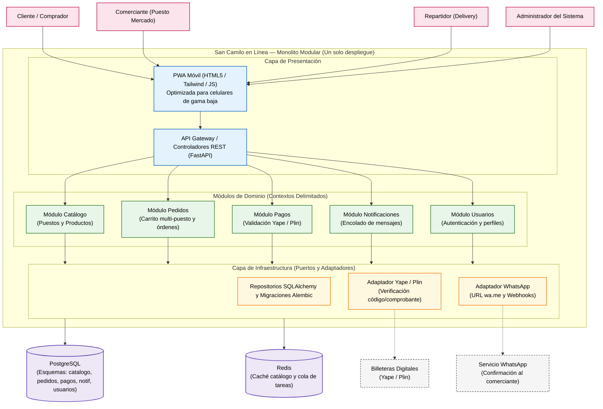
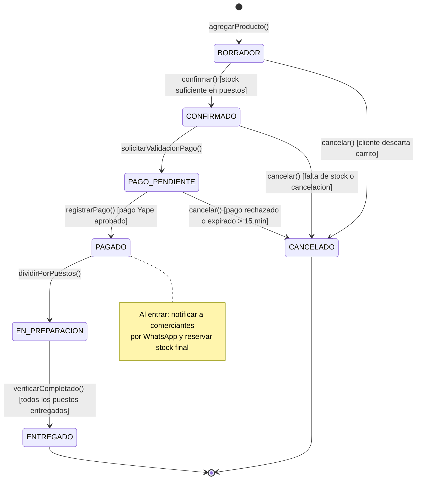

# San Camilo en Línea — Laboratorio 04: Fundamentos de arquitectura de software
Construcción de Software · EPIS-UNSA · 2026-B · Grupo 07

---

## Integrantes

| Nombre | Rol en el laboratorio |
|:---|:---|
| **Estudiante 1** | Redactor de ADRs y modelador de arquitectura de dominio |
| **Estudiante 2** | Diagramador de modelos (Mermaid, PlantUML y Python Diagrams) |
| **Estudiante 3** | Verificador crítico de IA y analista de drivers / escenarios de calidad |

---

## Caso

**San Camilo en Línea** es una plataforma web y móvil (PWA) orientada a digitalizar el comercio tradicional del emblemático Mercado San Camilo de Arequipa. El sistema permite a los clientes consultar catálogos independientes por puesto, agrupar productos de diversos puestos en un único carrito de compras, pagar mediante transferencia Yape y despachar órdenes con confirmación automática a cada comerciante por WhatsApp, bajo modalidades de recojo en tienda o delivery unificado.

El **atributo de calidad crítico** es la **capacidad de interacción / usabilidad en celulares de gama baja**: un comerciante con escasa experiencia digital debe poder publicar productos o confirmar pedidos en **$\le 3$ toques** de pantalla desde un smartphone Android básico ($\le 2\text{ GB}$ de RAM) bajo las condiciones de conectividad 3G intermitente del mercado.

---

## Arquitectura elegida

A continuación se presenta el diagrama de arquitectura del **Monolito Modular** estructurado en capas limpias y puertos y adaptadores:

---

## Decisiones arquitectónicas

- [ADR-001: Adoptar un monolito modular para el MVP de San Camilo en Línea](docs/architecture/adr/001-estilo-arquitectonico.md)
- [ADR-002: Persistencia centralizada en PostgreSQL con esquemas aislados por módulo](docs/architecture/adr/002-estrategia-persistencia.md)
- [ADR-003: Integración de pagos con Yape y notificaciones por WhatsApp mediante Puertos y Adaptadores](docs/architecture/adr/003-estrategia-notificaciones-y-pagos.md)
- [ADR-005: Patrones de Diseño GoF adoptados y rechazados en la refactorización de Pedidos](docs/architecture/adr/005-patrones-adoptados-y-rechazados.md)

---

## Cuestionario Teórico

Las respuestas completas a las 8 preguntas conceptuales de la Sección IV de la guía se encuentran documentadas en:
- [Cuestionario de Fundamentos de Arquitectura de Software](docs/architecture/cuestionario.md)

---

## Diseño UML (Lab 05)

### 1. Historia de Usuario Crítica y Criterios
- [HU-01: Pedido a múltiples puestos con pago unificado vía Yape](docs/design/historia.md)

### 2. Máquina de Estados del Pedido (Mermaid)

### 3. Diagramas de Diseño y Enlaces
- **Diagrama de Clases (E1):** [clases.puml](docs/design/clases.puml) · [Render PNG](docs/design/img/clases.png)
- **Diagrama de Secuencia (E2):** [secuencia-confirmar-pedido.puml](docs/design/secuencia-confirmar-pedido.puml) · [Render PNG](docs/design/img/secuencia-confirmar-pedido.png)
- **Diagrama de Máquina de Estados (E3):** [estados-pedido.mmd](docs/design/estados-pedido.mmd) · [Render PNG](docs/design/img/estados-pedido.png)
- **Diagrama de Actividades (E4):** [actividades-consolidar-pedido.puml](docs/design/actividades-consolidar-pedido.puml) · [Render PNG](docs/design/img/actividades-consolidar-pedido.png)
- **Diagrama de Paquetes (E5):** [paquetes.puml](docs/design/paquetes.puml) · [Render PNG](docs/design/img/paquetes.png)

### 4. Ingeniería Directa e Inversa (Round-Trip) y Consistencia
- **Código de Dominio (Python 3.10):** [src/pedidos/dominio.py](src/pedidos/dominio.py)
- **Diagrama Inverso (pyreverse):** [classes_pedidos.puml](docs/design/classes_pedidos.puml) · [Render PNG](docs/design/img/classes_pedidos.png)
- **Análisis Round-Trip (E6):** [round-trip.md](docs/design/round-trip.md)
- **Auditoría de Consistencia C1-C5 (E7):** [consistencia.md](docs/design/consistencia.md)
- **Bitácora de Uso de IA (E7):** [bitacora-ia.md](docs/design/bitacora-ia.md)

---

## Patrones de diseño (Lab 07)

Refactorización orientada a patrones GoF sobre el flujo central de pedidos y pagos (`src/pedidos/servicio.py`), guiada por métricas objetivas de complejidad ciclomática (`radon`) y una red de seguridad de 44 pruebas automatizadas (`pytest`).

### 1. Mapeo: Olor de código → Patrón GoF → Prueba automatizada

| Olor de código (Code Smell) | Patrón GoF aplicado | Prueba automatizada en `tests/` | Entregable / Código |
|:---|:---|:---|:---|
| **Condicionales por medio de pago** (`if/elif` con Yape/Plin) y acoplamiento a SDKs heterogéneos | **Strategy** + **Adapter** + **Factory Method con registro** | `test_open_closed_nuevo_medio_sin_modificar_el_servicio` `test_adapter_aisla_sdk_yape` `test_adapter_aisla_client_plin` | **E2:** [`pagos.py`](src/pedidos/pagos.py) · [`pagos.puml`](docs/design/patrones/pagos.puml) |
| **Bucles de reintento duplicados** (`for intento in range(3)`) mezclados en el flujo de negocio | **Decorator** (`ConReintentos`, `ConLogTransacciones`) | `test_decorator_reintentos_solo_en_timeout_no_en_rechazo` `test_decorator_composicion_reintentos_y_log` | **E2:** [`pagos.py`](src/pedidos/pagos.py) |
| **Mutaciones y condicionales anidados sobre strings de estado** (`pedido.estado`), propensos a estados inconsistentes | **State** (`EstadoPedido`, `Borrador`, `Confirmado`, `Pagado`, `Cancelado`) | `test_state_impide_transiciones_invalidas` `test_state_transiciones_validas_ciclo_completo` `test_state_cancelacion_desde_borrador_y_confirmado` | **E3:** [`estados.py`](src/pedidos/estados.py) · [`estados.puml`](docs/design/patrones/estados.puml) |
| **Notificaciones y auditoría acopladas manualmente** (`eventos.append(...)`) en el flujo transaccional | **Observer** (`PublicadorEventos`, `Suscriptor`, `NotificadorWhatsApp`) | `test_observer_notifica_a_multiples_suscriptores` `test_observer_nuevo_suscriptor_sin_tocar_el_servicio` `test_observer_desuscribir` | **E4:** [`eventos.py`](src/pedidos/eventos.py) |
| **Acoplamiento a API externa de LLM y alucinaciones de precios** sin moderación determinista | **Strategy** + **Adapter** + **Decorator** + **Chain of Responsibility** | `test_ia_mock_adapter_normaliza_correctamente` `test_ia_decorator_con_cache_evita_llamadas_repetidas` `test_ia_guardrail_sin_precios_bloquea_precio_inventado` | **E5:** [`ia.py`](src/pedidos/ia.py) · [`ia.puml`](docs/design/patrones/ia.puml) |

### 2. Tabla Comparativa de Métricas (Radon 6.0.1)

| Métrica / Elemento | Versión Inicial (`antes`) | Versión con Patrones (`después`) | Variación / Impacto |
|:---|:---:|:---:|:---|
| **Complejidad ciclomática de `confirmar_y_pagar`** | **15 (Rango C)** | **2 (Rango A)** | **−86.7%** (Flujo lineal y simple) |
| **Complejidad promedio del código** | **5.50 (Rango B)** | **1.84 (Rango A)** | **−66.5%** (Alta simplificación por delegación) |
| **Complejidad máxima del módulo** | 15 (`confirmar_y_pagar`) | 5 (`SinPrecios._aplicar` / `__init__`) | Ningún método supera el umbral crítico de 10 |
| **SLOC del orquestador (`servicio.py`)** | 85 SLOC | 42 SLOC | **−50.6%** (El servicio se redujo a la mitad) |
| **Líneas totales de dominio (SLOC)** | 85 SLOC | 314 SLOC (5 módulos modulares) | +269.4% (Costo de interfaces y abstracciones) |
| **Índice de Mantenibilidad (MI)** | 52.75 (Rango A) | **81.46 (Rango A)** | **+28.71 puntos** en el servicio de aplicación |
| **Archivos a modificar para nuevo medio de pago** | 1 (`servicio.py`) | **0** (solo registrar en `FabricaPasarelas`) | Cumplimiento estricto de **OCP** |
| **Cobertura de pruebas automatizadas** | 26 pruebas | 44 pruebas (100% pasando, 1 xfail documentado) | Red de seguridad completa |

### 3. Índice de Entregables de Patrones (Lab 07)

- **E1: Detección de Olores de Código y Métricas:** [olores.md](docs/design/patrones/olores.md)
- **E2: Patrones Creacionales y Estructurales de Pagos (Strategy, Adapter, Decorator, Factory):** [pagos.py](src/pedidos/pagos.py) · [pagos.puml](docs/design/patrones/pagos.puml)
- **E3: Ciclo de Vida del Pedido (State):** [estados.py](src/pedidos/estados.py) · [estados.puml](docs/design/patrones/estados.puml)
- **E4: Desacoplamiento de Notificaciones (Observer):** [eventos.py](src/pedidos/eventos.py)
- **E5: Aislamiento de IA y Guardrails (Chain of Responsibility, Adapter, Cache):** [ia.py](src/pedidos/ia.py) · [ia.puml](docs/design/patrones/ia.puml)
- **E6: Métricas y Análisis de Trade-Off:** [metricas.md](docs/design/patrones/metricas.md)
- **E7: Bitácora de Uso de IA:** [bitacora-ia.md](docs/design/patrones/bitacora-ia.md)
- **E8: Decisión Arquitectónica ADR-005:** [ADR-005](docs/architecture/adr/005-patrones-adoptados-y-rechazados.md)

---

## Reflexión sobre el uso de la IA (5 a 8 líneas)

El asistente de IA demostró ser una herramienta de gran valor para acelerar la redacción formal de escenarios de calidad y estructurar la sintaxis de diagramas en Mermaid, PlantUML y Python Diagrams. Sin embargo, presentó sesgos notorios hacia la sobre-ingeniería inicial (sugiriendo microservicios con Kubernetes y brokers pesados) y alucinó capacidades inexistentes, como afirmar que Yape dispone de una API pública gratuita para pequeños comerciantes. La lección fundamental para el equipo fue que la IA propone con rapidez pero carece de criterio sobre las restricciones del mundo real; por tanto, el juicio crítico humano y la validación técnica contra costos reales, plazos estrictos y el contexto operativo del usuario final son insustituibles en la ingeniería de software.
