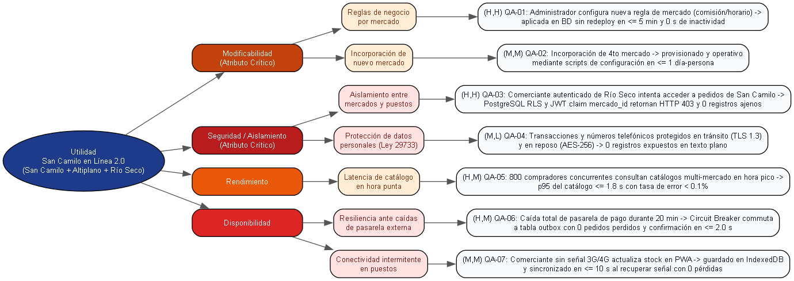
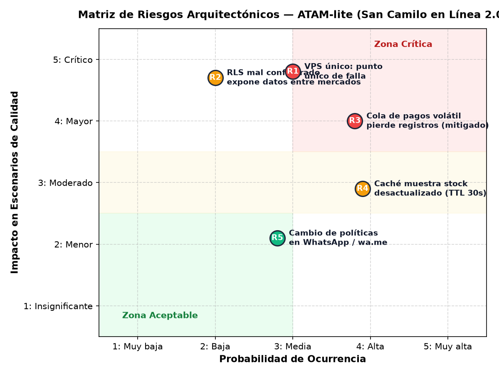

# San Camilo en Línea 2.0 — Plataforma Multi-Mercado

[](https://github.com/giovani202320/Costruccion_Software/actions/workflows/fitness.yml)


Repositorio oficial del proyecto **San Camilo en Línea (Caso 7)** para la asignatura de **Construcción de Software** (EPIS-UNSA, 2026-B).

---

## Diseño de la Arquitectura (Lab 08)

En esta fase, la plataforma evoluciona hacia **San Camilo en Línea 2.0** ante su escenario de crecimiento crítico:
> **Detonante de Crecimiento (Caso 7):** *"Se suman los mercados Altiplano y Río Seco, cada uno con sus reglas y comerciantes."*  
> **Atributos Críticos:** **Modificabilidad** (reglas de negocio dinámicas por mercado sin redeploy) y **Aislamiento** (seguridad y multitenencia estricta entre puestos y mercados competidores).

La arquitectura se diseñó y verificó mediante el método **Attribute-Driven Design (ADD 3.0)**, evaluada con **ATAM-lite** y protegida en Integración Continua mediante **Fitness Functions automatizadas**.

---

### 1. Árbol de Utilidad

Estructura formal que organiza los 4 atributos de calidad (Modificabilidad, Seguridad, Rendimiento, Disponibilidad) y prioriza 7 escenarios cuantitativos de seis partes:



*Documentación completa:* [`docs/architecture/utilidad/README.md`](docs/architecture/utilidad/README.md) y código Graphviz [`arbol.dot`](docs/architecture/utilidad/arbol.dot).

---

### 2. Tabla Consolidada de Iteraciones ADD (E2 y E4)

| Iteración | Escenario Objetivo | Táctica Adoptada (Bass et al.) | Evidencia Cuantitativa (Simulación / Prototipo) | ¿Cumple? |
|:---:|:---|:---|:---|:---:|
| **Iteración 1** | **QA-01 (H, H):** Modificabilidad de reglas en $\le 5$ min.<br>**QA-03 (H, H):** Aislamiento multitenant (0 fugas). | **PostgreSQL Row-Level Security (RLS)** + **Claim JWT `mercado_id`** + **Gestor dinámico de reglas en memoria/BD**. | Simulación en [`fitness/multitenencia_reglas.py`](fitness/multitenencia_reglas.py):<br>• Aislamiento: 0 fugas de datos en 1,000 accesos cruzados (100% aislamiento).<br>• Reglas dinámicas: tiempo de aplicación medido en **$0.002\text{ ms}$** con 0 s de downtime. | **SÍ** |
| **Iteración 2** | **QA-05 (H, M):** Rendimiento del catálogo multi-mercado ($p95 \le 1.8\text{ s}$ a 24 req/s en hora pico). | **Índice compuesto B-tree (`mercado_id, puesto_id, activo`)** en PostgreSQL + **Caché en memoria local con TTL 30 s**. | Simulación de cola $M/G/c$ en [`fitness/rendimiento.py`](fitness/rendimiento.py):<br>• Sin tácticas: $4,762.2\text{ ms}$ (saturación).<br>• Con índice en BD: $32.4\text{ ms}$.<br>• Con índice + caché (85% hits): **$21.2\text{ ms}$** ($\le 1,800\text{ ms}$). | **SÍ** |
| **Iteración 3** | **QA-06 (H, M):** Disponibilidad en pagos (0 pedidos perdidos ante 20 min de caída de pasarela externa). | **Decorador Circuit Breaker** + **Tabla transaccional `pagos.outbox` en PostgreSQL** + **Worker asíncrono**. | Simulación Monte Carlo en [`fitness/disponibilidad.py`](fitness/disponibilidad.py):<br>• Sin tácticas: 189 pedidos perdidos.<br>• Reintentos simples: 57 pedidos perdidos y 171 llamadas al proveedor.<br>• Circuit Breaker + Outbox: **0 pedidos perdidos** y solo 11 llamadas de sondeo (-93% sobrecarga). | **SÍ** |

*Registros de iteraciones:* [`Iteración 1`](docs/architecture/add/iteracion-1.md) · [`Iteración 2`](docs/architecture/add/iteracion-2.md) · [`Iteración 3`](docs/architecture/add/iteracion-3.md).

---

### 3. Registro de Decisiones de Arquitectura (ADR)

- [`ADR-001: Adoptar un Monolito Modular para el MVP de San Camilo en Línea`](docs/architecture/adr/001-estilo-arquitectonico.md)
- [`ADR-005: Patrones GoF adoptados y rechazados en Pedidos`](docs/architecture/adr/005-patrones-adoptados-y-rechazados.md)
- [`ADR-006: Adopción de índice compuesto y caché en memoria para catálogo multi-mercado`](docs/architecture/adr/006-indice-y-cache-catalogo.md)
- [`ADR-007: Resiliencia en pagos mediante Circuit Breaker y persistencia Outbox`](docs/architecture/adr/007-resiliencia-pagos-circuit-breaker-outbox.md)
- [`ADR-008: Multitenencia mediante discriminador de mercado, PostgreSQL RLS y reglas dinámicas`](docs/architecture/adr/008-multitenencia-aislamiento-reglas.md)

---

### 4. Modelo C4 de Contenedores Actualizado

Se actualizó el modelo C4 en Structurizr DSL con trazabilidad bidireccional a los escenarios de calidad entre corchetes `[QA-xx]`:
- Archivo fuente: [`docs/c4/workspace.dsl`](docs/c4/workspace.dsl).

---

### 5. Evaluación ATAM-lite y Matriz de Riesgos

Informe detallado con evaluación cruzada, puntos de sensibilidad, trade-offs y matriz de riesgos en [`docs/architecture/atam-lite.md`](docs/architecture/atam-lite.md):



*Bitácora de IA y Falsos Positivos Refutados:* [`docs/architecture/bitacora-ia.md`](docs/architecture/bitacora-ia.md) (registra 12 interacciones críticas con falsos positivos de microservicios, caché fría y workers refutados con datos cuantitativos).

---

### 6. Fitness Functions en Integración Continua (CI)

La integridad de la arquitectura se protege mediante compuertas de calidad automatizadas en cada Pull Request (`.github/workflows/fitness.yml`):

1. **Estructurales (`.importlinter`):**
   - **FF-01:** Capas del monolito modular sin ciclos (ADR-001).
   - **FF-02:** El dominio y servicios no conocen las SDKs externas (ADR-005).
2. **De Calidad (`tests/test_fitness.py` con `pytest`):**
   - **FF-03:** Presupuesto de latencia en hora punta ($p95 \le 1800\text{ ms}$).
   - **FF-04:** Aislamiento multitenant con 0 fugas de datos entre mercados.
   - **FF-05:** Cero pedidos perdidos ante caída del proveedor de pagos.
   - **FF-06:** Reducción de llamadas del Circuit Breaker al proveedor caído ($> 5\times$).
   - **FF-07:** Modificabilidad de reglas por mercado en caliente sin downtime.

---

## Ejecución Local y Verificación

```powershell
# 1. Instalar dependencias
pip install pytest import-linter matplotlib

# 2. Ejecutar fitness functions estructurales
$env:PYTHONPATH="src"
lint-imports

# 3. Ejecutar fitness functions de calidad
$env:PYTHONPATH="src;."
pytest -v tests/test_fitness.py

# 4. Ejecutar simulaciones y regenerar gráficos
python fitness/rendimiento.py
python fitness/disponibilidad.py
python fitness/multitenencia_reglas.py
python fitness/matriz_riesgos.py
```
