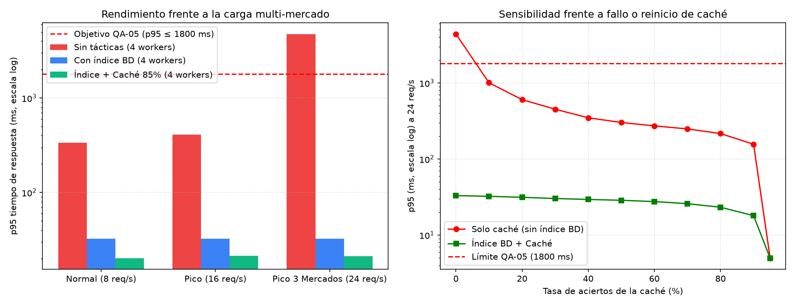

# ADD Iteración 2: Rendimiento del Catálogo Multi-Mercado en Hora Punta (QA-05)

- **Caso:** San Camilo en Línea 2.0 (Grupo 07)
- **Detonante de crecimiento:** La suma de puestos y compradores de los mercados San Camilo, Altiplano y Río Seco triplica las consultas concurrentes al catálogo en domingos pico (24 req/s).
- **Entregable:** E4 (Iteración 2 de ADD).

---

## 1. Paso 1 de ADD: Revisar las entradas

| Insumo | Origen | Qué aporta a esta iteración |
|:---|:---|:---|
| **Drivers y restricciones** | [`drivers.md`](../drivers.md) | Presupuesto $0 USD (R-03), servidor VPS modesto con 4 workers Python/Gunicorn. |
| **Estilo y estado previo** | ADD Iteración 1 | Monolito modular con base de datos única y discriminador `mercado_id`. |
| **Escenario objetivo** | [`arbol-utilidad.md`](../utilidad/README.md) | **QA-05 (H, M):** 800 compradores concurrentes consultan catálogos multi-mercado en hora pico $\to$ **$p95 \le 1.8\text{ s}$** ($1800\text{ ms}$) y tasa de error $\lt 0.1\%$. |

---

## 2. Paso 2 de ADD: Elegir el objetivo de la iteración

Garantizar que la latencia del catálogo y la búsqueda de productos en los 3 mercados se mantenga por debajo de $1.8\text{ s}$ en percentil 95 ($p95$) durante las horas pico de abastecimiento dominical, sin exceder el presupuesto de infraestructura ($0 USD/mes).

---

## 3. Paso 3 de ADD: Elegir qué parte del sistema refinar

- **Módulo `catalogo`:** Lógica de filtrado de productos por mercado y puesto.
- **Capa de persistencia:** Índices en PostgreSQL sobre la tabla `catalogo.producto`.
- **Capa de caché en memoria:** Almacenamiento temporal de vistas de catálogo por puesto/mercado con invalidación temporal (TTL).

---

## 4. Paso 4 de ADD: Elegir conceptos de diseño (Tácticas y Patrones)

| Concepto de diseño | Táctica (Bass et al.) | Propuesta de la IA | Evaluación y Decisión del Equipo |
|:---|:---|:---|:---|
| **Escalar a 8 workers en un segundo VPS** | *Aumentar recursos* | "Desplegar un segundo VPS con un load balancer para repartir la carga a 8 workers." | **Rechazada:** Viola R-03 (duplica el costo operativo mensual). Queda documentada únicamente como plan de contingencia futuro. |
| **Índice compuesto en PostgreSQL (`mercado_id, puesto_id, activo`)** | *Optimizar consultas / Gestionar recursos* | "Crear un índice compuesto B-tree para evitar los escaneos secuenciales de tabla completa." | **Aceptada:** Costo en memoria/disco mínimo; reduce drásticamente el tiempo de servicio de la base de datos de $\sim 160\text{ ms}$ a $\sim 18\text{ ms}$. |
| **Caché en memoria local / Redis con TTL de 30 s** | *Caché* | "Cachear el payload JSON del catálogo con invalidación temporal de 30 segundos." | **Aceptada (ADR-006):** Provee un margen de seguridad vital amortiguando el 85% de las lecturas repetitivas sin complejidad de invalidación distribuida. |

---

## 5. Paso 5 y 6 de ADD: Instanciación, responsabilidades y ADR

- Se crea el índice compuesto en la migración de base de datos:
  ```sql
  CREATE INDEX idx_productos_mercado_puesto_activo 
  ON catalogo.producto (mercado_id, puesto_id, activo);
  ```
- Se implementa un decorador de caché en memoria con TTL de 30 segundos en el servicio de catálogo.
- **ADR generado:** [`ADR-006: Adopción de índice compuesto y caché en memoria para catálogo multi-mercado`](../adr/006-indice-y-cache-catalogo.md).

---

## 6. Paso 7 de ADD: Evidencia Cuantitativa (Simulación de Cola M/G/c)

Se adaptó y ejecutó el modelo de teoría de colas $M/G/c$ en [`fitness/rendimiento.py`](file:///c:/Users/giovani/Documents/SanCamilo/cs-2026b-lab04-grupo07/fitness/rendimiento.py) bajo carga normal (8 req/s), pico regular (16 req/s) y pico multi-mercado (24 req/s):



### Resultados numéricos comparativos

| Nivel de Carga | Sin Tácticas (4 workers) | Con Índice en BD | Índice + Caché (85% hit) | Presupuesto QA-05 | ¿Cumple? |
|:---|:---:|:---:|:---:|:---:|:---:|
| **Normal (8 req/s)** | $336.3\text{ ms}$ | $32.3\text{ ms}$ | $20.2\text{ ms}$ | $\le 1800\text{ ms}$ | **SÍ** |
| **Pico regular (16 req/s)** | $411.2\text{ ms}$ | $32.5\text{ ms}$ | $21.3\text{ ms}$ | $\le 1800\text{ ms}$ | **SÍ** |
| **Pico 3 Mercados (24 req/s)** | **$4,762.2\text{ ms}$ (Saturación)** | **$32.4\text{ ms}$** | **$21.2\text{ ms}$** | $\le 1800\text{ ms}$ | **SÍ** |

### Hallazgo que corrige la afirmación de la IA:
La IA afirmó originalmente que *"con solo una capa de caché se garantiza el rendimiento sin necesidad de tocar la base de datos"*. Sin embargo, la **curva de sensibilidad** demostró que ante una tasa de aciertos baja ($\lt 20\%$, por ejemplo en el arranque en frío o tras una invalidación masiva), el $p95$ colapsa a más de $4,000\text{ ms}$. Por ende, **el índice en base de datos es la garantía estructural del sistema**, mientras que la caché actúa como amortiguador de picos.
