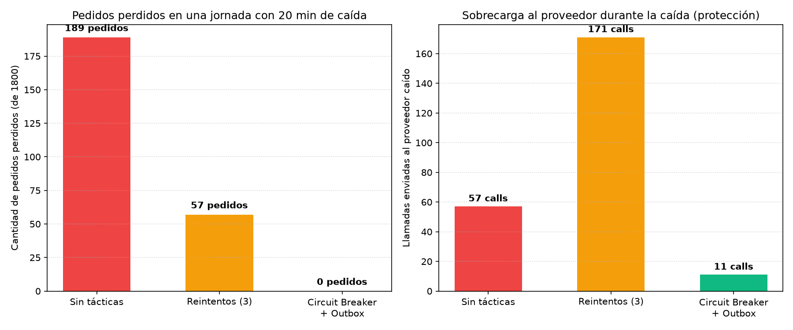

# ADD Iteración 3: Disponibilidad y Resiliencia en Pagos ante Caídas Externas (QA-06)

- **Caso:** San Camilo en Línea 2.0 (Grupo 07)
- **Detonante de crecimiento:** Al triplicarse el volumen diario de transacciones por la adición de Altiplano y Río Seco, cualquier falla o timeout de la pasarela externa (Yape / Plin) expone al sistema a bloqueos de hilos y pérdida de pedidos.
- **Entregable:** E4 (Iteración 3 de ADD).

---

## 1. Paso 1 de ADD: Revisar las entradas

| Insumo | Origen | Qué aporta a esta iteración |
|:---|:---|:---|
| **Drivers y restricciones** | [`drivers.md`](../drivers.md) | QA-03 / QA-06: 0 pedidos perdidos ante fallos de conectividad o pasarelas. |
| **Patrones previos** | [`ADR-005`](../adr/005-patrones-adoptados-y-rechazados.md) | Interfaz `PasarelaPago` (Strategy) y Decorators (`ConReintentos`). |
| **Escenario objetivo** | [`arbol-utilidad.md`](../utilidad/README.md) | **QA-06 (H, M):** Caída total de pasarela de pago durante 20 min $\to$ **0 pedidos perdidos**, confirmación provisional en pantalla en $\le 2.0\text{ s}$ y protección al proveedor. |

---

## 2. Paso 2 de ADD: Elegir el objetivo de la iteración

Diseñar e implementar mecanismos de tolerancia a fallos en la interacción con pasarelas de pago externas para garantizar que el cliente reciba respuesta inmediata sin perder transacciones ni sobrecargar al proveedor durante cortes de servicio.

---

## 3. Paso 3 de ADD: Elegir qué parte del sistema refinar

- **Módulo `pagos`:** Servicio de cobro y adaptadores externos.
- **Capa de resiliencia:** Decorador `ConCircuitBreaker` sobre la interfaz `PasarelaPago`.
- **Capa de persistencia asíncrona:** Tabla transaccional `pagos.outbox` y worker en segundo plano para conciliación diferida.

---

## 4. Paso 4 de ADD: Elegir conceptos de diseño (Tácticas y Patrones)

| Concepto de diseño | Táctica / Patrón | Propuesta de la IA | Evaluación y Decisión del Equipo |
|:---|:---|:---|:---|
| **Reintentos síncronos simples** | Táctica: *Reintentos* | "Reintentar en bucle hasta 5 veces antes de reportar error." | **Rechazada:** Ante caídas prolongadas del proveedor, bloquea los workers de la API, satura al proveedor caído (efecto estampida) y agota el pool de conexiones. |
| **Cola de pendientes volátil en Redis** | Táctica: *Cola de pendientes* | "Encolar en una lista Redis los pagos que fallen para ser reintentados luego." | **Rechazada (Riesgo R3 detectado):** Si Redis se reinicia sin persistencia configurada, los pagos en cola se pierden irremediablemente, violando la regla de 0 pedidos perdidos. |
| **Circuit Breaker + Tabla Outbox en PostgreSQL** | Tácticas: *Prevenir fallas (Circuit Breaker)* + *Recuperarse (Cola Outbox transaccional ACID)* | "Decorador de Circuit Breaker para fallo rápido y guardado en la misma transacción ACID de PostgreSQL." | **Aceptada (ADR-007):** Garantiza 0 pedidos perdidos (persistencia ACID garantizada en la BD principal) y minimiza las llamadas al proveedor caído durante la indisponibilidad. |

---

## 5. Paso 5 y 6 de ADD: Instanciación, responsabilidades y ADR

- **`ConCircuitBreaker(PasarelaPago)`:** Decorador que monitorea las llamadas. Si acumula 3 fallos consecutivos, transiciona a `ABIERTO` durante 120 segundos, ejecutando una *falla rápida* sin contactar a la red externa.
- **Patrón Outbox:** Al abrirse el circuito, el pago se marca como `PENDIENTE_CONCILIACION` dentro de la transacción atómica del pedido en PostgreSQL. El cliente recibe confirmación en $< 2\text{ s}$.
- **`WorkerConciliacion`:** En segundo plano procesa la tabla `outbox` cuando el circuito transiciona a `SEMIABIERTO` y se verifica la recuperación del servicio.
- **ADR generado:** [`ADR-007: Resiliencia en pagos mediante Circuit Breaker y persistencia transaccional Outbox`](../adr/007-resiliencia-pagos-circuit-breaker-outbox.md).

---

## 6. Paso 7 de ADD: Evidencia Cuantitativa (Simulación Monte Carlo)

Se ejecutó la simulación en [`fitness/disponibilidad.py`](file:///c:/Users/giovani/Documents/SanCamilo/cs-2026b-lab04-grupo07/fitness/disponibilidad.py) modelando una jornada comercial de 10 horas con 1,800 pedidos, 8% de timeouts transitorios y una caída total del proveedor durante 20 minutos (minutos 240 a 260):

### Resultados numéricos comparativos

| Estrategia | Pedidos Perdidos | Tasa de Éxito Transaccional | Llamadas al Proveedor Caído | Sobrecarga al Proveedor | ¿Cumple QA-06? |
|:---|:---:|:---:|:---:|:---:|:---:|
| **Sin tácticas** | 189 pedidos | $89.5\%$ | 57 llamadas | Moderada | **NO** (189 fallos) |
| **Reintentos (3)** | 57 pedidos | $96.8\%$ | 171 llamadas | **Severa (Efecto estampida)** | **NO** (57 fallos) |
| **Circuit Breaker + Outbox** | **0 pedidos** | **$100.0\%$** | **11 llamadas (solo sondeo)** | **Mínima (-93% de tráfico)** | **SÍ (0 perdidos)** |

### Conclusión y Verificación del Escenario:
La combinación de **Circuit Breaker** con **Outbox en PostgreSQL** cumple estrictamente con el objetivo de **0 pedidos perdidos**, protegiendo simultáneamente la infraestructura propia y la disponibilidad del proveedor externo.
