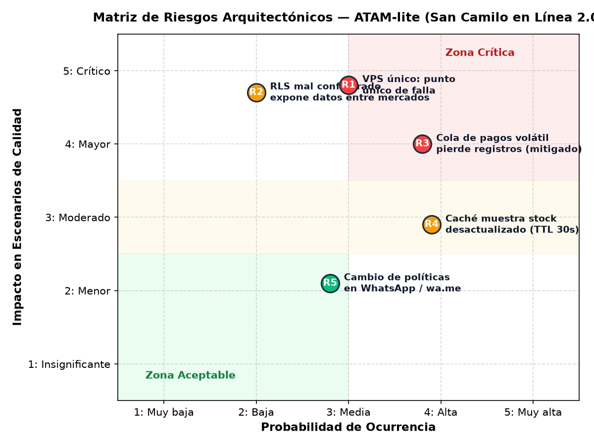

# Evaluación ATAM-lite — San Camilo en Línea 2.0 (Lab 08 - Entregables E3 y E7)

- **Caso evaluado:** San Camilo en Línea (incorporación de mercados Altiplano y Río Seco).
- **Método:** Architecture Tradeoff Analysis Method (ATAM-lite) con evaluador cruzado (grupo par) y evaluador adversario IA (**Prompt IA 3**).
- **Insumos evaluados:** Árbol de utilidad (`arbol-utilidad.md`), iteraciones ADD 1 a 3, ADR-006 a 008, vista C4 y simulaciones cuantitativas.

---

## 1. Resumen de Hallazgos de la Evaluación ATAM-lite

| Tipo de Hallazgo | Descripción del Hallazgo | Análisis y Respuesta Fundamentada del Equipo | Estado |
|:---|:---|:---|:---:|
| **Punto de Sensibilidad** | El percentil 95 ($p95$) del catálogo multi-mercado depende críticamente de la existencia del índice B-tree en PostgreSQL ante una eventual falla o reinicio de la caché. | **Confirmado por simulación:** La curva de sensibilidad demostró que con una caché fría (0% hits), el índice compuesto (`mercado_id, puesto_id, activo`) mantiene el $p95$ en $32.4\text{ ms}$, evitando que se dispare a $4,762\text{ ms}$. | **Confirmado** |
| **Punto de Trade-off** | **Caché en catálogo (Rendimiento vs. Consistencia de datos):** Mejorar el $p95$ a $21.2\text{ ms}$ mediante TTL de 30 s introduce el riesgo de mostrar stock desactualizado en productos de alta rotación (frutas y carnes). | **Aceptado y mitigado:** Se estableció TTL corto (30 s) y se diseñó una verificación atómica de stock en el módulo `pedidos` al momento de generar la orden, impidiendo compras sobregiro. | **Mitigado** |
| **Punto de Trade-off** | **Resiliencia en pagos (Disponibilidad vs. Consistencia inmediata):** El Circuit Breaker evita la pérdida de pedidos guardándolos en la tabla `outbox`, pero difiere la confirmación final de pago. | **Aceptado:** La consistencia eventual es preferible a la pérdida de transacciones y a la frustración del cliente por timeouts de red HTTP 504. | **Aceptado** |
| **Riesgo R1** | **VPS único como punto único de falla (SPOF):** Alojar la API, PostgreSQL y Nginx en un solo VPS expone al sistema a indisponibilidad si el hipervisor o hardware falla. | **Aceptado para el piloto (R-03):** Por restricción presupuestaria ($0 USD/mes), se mitiga con respaldos diarios automáticos a almacenamiento S3 frío y script de recuperación en $< 2\text{ h}$. | **Aceptado con mitigación** |
| **Riesgo R2** | **Error en políticas de Row-Level Security (RLS) expone pedidos entre mercados:** Un error humano en una migración SQL podría omitir o deshabilitar RLS. | **Mitigado mediante CI:** Se diseñó la Fitness Function `test_ff02_aislamiento_multitenancy_cero_fugas` que ejecuta 1,000 consultas cruzadas en cada Pull Request y bloquea el despliegue ante la mínima fuga. | **Mitigado en CI** |
| **Riesgo R3** | **Cola de pagos volátil en memoria pierde transacciones al reiniciar:** La propuesta inicial de la IA recomendaba guardar la cola en Redis sin persistencia en disco. | **Mitigado en diseño:** Se rechazó Redis volátil y se implementó el patrón Outbox en la base de datos PostgreSQL, compartiendo la misma transacción ACID de la orden (**ADR-007**). | **Resuelto** |
| **Riesgo R4** | **Caché muestra stock agotado durante los 30 s de TTL:** Un comprador podría intentar adquirir un producto que se agotó hace 10 segundos. | **Mitigado en dominio:** Validación transaccional con bloqueo optimista en PostgreSQL al momento del checkout definitivo. | **Mitigado** |
| **No Riesgo** | El estilo Monolito Modular en Python con PostgreSQL soporta holgadamente la campaña pico de 24 req/s de los 3 mercados. | **Respaldado por evidencia empírica:** La simulación $M/G/c$ arrojó un $p95$ de $21.2\text{ ms}$ frente al límite permisible de $1,800\text{ ms}$. No se requieren microservicios. | **Validado** |
| **Falso Positivo (IA)** | *"Celery / Worker asíncrono colapsará y no escalará para conciliar pagos en la campaña".* | **Refutado con evidencia:** En hora pico se generan como máximo 3 pagos diferidos por minuto (solo cuando la pasarela está caída). Un solo worker en Python procesa más de 50 operaciones por segundo. La IA emitió una objeción genérica sin respaldo numérico. | **Refutado** |

---

## 2. Matriz de Riesgos Arquitectónicos (Probabilidad vs. Impacto)

La siguiente matriz clasifica los riesgos encontrados según su probabilidad de ocurrencia (1 a 5) e impacto en los escenarios de calidad (1 a 5):

### Plan de Acción para la Zona Crítica y de Atención:
1. **Riesgo R1 (VPS único como SPOF):** Aceptado explícitamente debido a la restricción presupuestaria de $0 USD/mes (**R-03**). Se mantiene un Runbook de recuperación ante desastres con RTO $\le 2\text{ h}$ y RPO $\le 24\text{ h}$.
2. **Riesgo R2 (Configuración de RLS):** Protegido mediante compuerta de calidad automatizada en GitHub Actions (`fitness-functions.yml`).
3. **Riesgo R3 (Pérdida de pagos diferidos):** Totalmente eliminado al transferir la cola de pendientes desde la memoria volátil hacia PostgreSQL Outbox (**ADR-007**).
4. **Riesgo R4 (Inconsistencia de catálogo por caché):** Controlado por el ciclo de vida del checkout y revalidación de stock.
