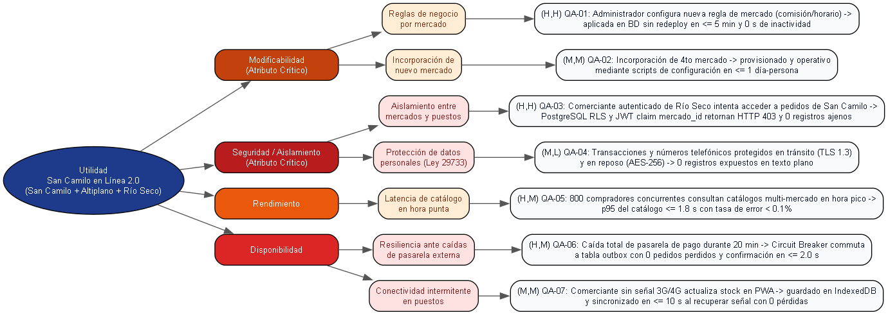

# Árbol de Utilidad — San Camilo en Línea 2.0 (Lab 08 - Entregable E1)

## 1. Contexto y Detonante del Rediseño

En el marco del **Laboratorio 08 (Attribute-Driven Design ADD 3.0, Tácticas y Evaluación ATAM-lite)**, la plataforma **San Camilo en Línea** (Caso 7) experimenta su escenario de crecimiento arquitectónico:
> **Detonante de crecimiento:** *"Se suman los mercados Altiplano y Río Seco, cada uno con sus reglas y comerciantes."*
> **Atributos críticos designados:** **Modificabilidad** y **Aislamiento (Seguridad / Multitenencia)**.

### Restricciones vigentes (de `drivers.md` y `ADR-001`):
- **R-01 (Plazo):** 1 mes para adaptar y estabilizar la plataforma ante el ingreso de los nuevos mercados.
- **R-02 (Equipo):** 3 desarrolladores con Python (FastAPI/Django) y PostgreSQL.
- **R-03 (Presupuesto):** $0 USD / mes (monolito modular sobre un único VPS o capa gratuita; no se permiten clústeres complejos de Kubernetes ni servicios cloud de pago).
- **Estilo arquitectónico base:** Monolito Modular con persistencia relacional única, no modificable a microservicios sin evidencia cuantitativa explícita.

---

## 2. Diagrama del Árbol de Utilidad

El árbol de utilidad organiza los atributos de calidad desde la utilidad global del sistema, refinándolos hasta escenarios concretos y medibles calificados con `(Importancia para el negocio, Dificultad técnica)` en escala `{Alta (H), Media (M), Baja (L)}`.

---

## 3. Especificación de Escenarios de Calidad (Formato de Seis Partes)

| ID | Atributo | Fuente | Estímulo | Entorno | Artefacto | Respuesta | Medida Numérica | Calificación (Negocio, Dificultad) |
|:---|:---|:---|:---|:---|:---|:---|:---|:---:|
| **QA-01** | **Modificabilidad** *(Crítico)* | Administrador de mercado | Configura una nueva regla de negocio para el Mercado Altiplano (recargo por horario extendido o comisión diferenciada por rubro) | Operación en producción, alta concurrencia de pedidos | Módulo de configuración y motor de políticas de negocio | El sistema persiste la configuración dinámica en BD y la aplica en memoria a los nuevos pedidos | **Regla aplicada en $\le 5$ minutos** sin reiniciar el servidor ni redesplegar código (**0 s de downtime**). | **(H, H)** |
| **QA-02** | **Modificabilidad** | Equipo de operaciones / Devs | Se aprueba e incorpora un cuarto mercado de abastos a la plataforma | Entorno de producción en régimen normal | Módulo de aprovisionamiento de tenants y catálogos | Se ejecuta script de alta que genera el identificador del mercado, rubros y estructura base | **Nuevo mercado operativo en $\le 1$ día-persona** sin alterar el esquema central ni el código fuente. | **(M, M)** |
| **QA-03** | **Seguridad / Aislamiento** *(Crítico)* | Comerciante autenticado del Mercado Río Seco | Intenta consultar o manipular pedidos, clientes o montos de liquidación del Mercado San Camilo mediante peticiones API alteradas | Operación concurrente regular con tokens JWT | Capa de persistencia (PostgreSQL RLS) y middleware de autorización | El sistema valida el claim `mercado_id` en el JWT y filtra forzosamente las consultas mediante Row-Level Security | **0 registros ajenos expuestos**; rechazo inmediato con código **HTTP 403 Forbidden**. | **(H, H)** |
| **QA-04** | **Seguridad** *(Datos personales)* | Agente malicioso o atacante externo | Intenta interceptar el tráfico de red o acceder al disco de respaldo para sustraer números de teléfono y transacciones | Conexión a través de redes públicas o acceso al almacenamiento | Capa de transporte y volumen de almacenamiento del VPS | El sistema aplica cifrado obligatorio TLS 1.3 en tránsito y cifrado LUKS/AES-256 en reposo conforme a la Ley N.º 29733 | **0 datos sensibles expuestos en texto plano** (100% de canales y respaldos cifrados). | **(M, L)** *(Corregido)* |
| **QA-05** | **Rendimiento** | 800 compradores concurrentes | Consultan y filtran catálogos de productos en múltiples puestos de los 3 mercados | Domingo por la mañana (hora punta de abastecimiento, 09:00 - 11:30 a. m.) | Módulo de Catálogo y Consulta (PostgreSQL + Caché en memoria) | El servicio atiende las consultas apoyándose en índices compuestos (`mercado_id, puesto_id, activo`) y caché con TTL | **p95 de respuesta $\le 1.8$ s**; tasa de error HTTP $\lt 0.1\%$. | **(H, M)** |
| **QA-06** | **Disponibilidad / Resiliencia** | Pasarela de pago externa (Yape / Banco) | Experimenta corte masivo o latencia excesiva (timeouts de red) durante 20 minutos consecutivos | Operación en horario pico comercial | Adaptador de pasarela y módulo de pagos diferidos | El circuito se abre (Circuit Breaker), evitando la saturación del hilo y derivando los pagos a una tabla transaccional *outbox* | **0 pedidos perdidos**; tiempo de confirmación provisional en pantalla $\le 2.0$ s; reintentos automáticos en segundo plano. | **(H, M)** |
| **QA-07** | **Disponibilidad / Usabilidad** | Comerciante en puesto físico | Registra ventas o confirma pedidos dentro de un pabellón con blindaje de sillar y pérdida total de señal 3G/4G | Pérdida temporal de red móvil por hasta 45 minutos | PWA offline-first (IndexedDB + Service Worker) | La aplicación almacena localmente el estado de las órdenes y sincroniza de forma transaccional al restaurar la conectividad | **0 operaciones perdidas**; sincronización automática en $\le 10$ s tras reanudar la conexión de red. | **(M, M)** |

---

## 4. Revisión y Corrección Crítica de la Propuesta de la IA

Siguiendo la **Regla de oro de la práctica**: *"La IA propone, el equipo decide con evidencia"*:

1. **Corrección de QA-04 (Protección de datos personales Ley 29733):**
   - **Propuesta de la IA:** La IA evaluó este escenario como **(H, H)**, argumentando alta gravedad legal y complejidad criptográfica.
   - **Decisión del equipo:** El equipo **lo redujo a (M, L)**. 
   - **Justificación técnica:** El cifrado en tránsito (HTTPS vía Let's Encrypt / reverse proxy Nginx) y el cifrado del disco en reposo del VPS ya fueron adoptados y resueltos en el Lab 04. La incorporación de los mercados Altiplano y Río Seco no introduce nuevos requerimientos criptográficos fuera de las configuraciones estándar ya existentes.
2. **Priorización de las Iteraciones ADD:**
   - Los escenarios calificados como **(H, H)** y **(H, M)** definen la hoja de ruta de las iteraciones de Attribute-Driven Design:
     - **Iteración 1:** QA-01 y QA-03 (Modificabilidad de reglas por mercado y Aislamiento con multitenencia / RLS).
     - **Iteración 2:** QA-05 (Rendimiento del catálogo ante la multiplicación de puestos y productos).
     - **Iteración 3:** QA-06 (Disponibilidad y resiliencia de pagos con Circuit Breaker y Outbox).

---

## 5. Lista de Verificación (Checklist de la Guía)
- [x] Contiene 4 atributos de calidad (Modificabilidad, Seguridad, Rendimiento, Disponibilidad).
- [x] Contiene 7 escenarios de calidad medibles (supera el mínimo de 6).
- [x] Ninguna medida dice adjetivos vagos como "rápido", "seguro" o "fácil" (todas son métricas exactas: $\le 5$ min, $p95 \le 1.8$ s, 0 registros, 0 pedidos perdidos).
- [x] Hay al menos un escenario `(H,H)` o `(H,M)` para cada atributo crítico del caso (**Modificabilidad**: QA-01 `(H,H)`; **Aislamiento/Seguridad**: QA-03 `(H,H)`).
- [x] Se aplicó y justificó la corrección de al menos una calificación propuesta por la IA (QA-04 de `(H,H)` a `(M,L)`).
- [x] Diagrama renderizado con Graphviz (`arbol.dot` $\to$ `arbol.png`).
